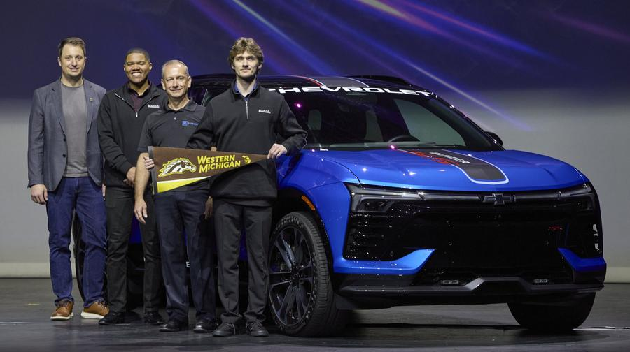
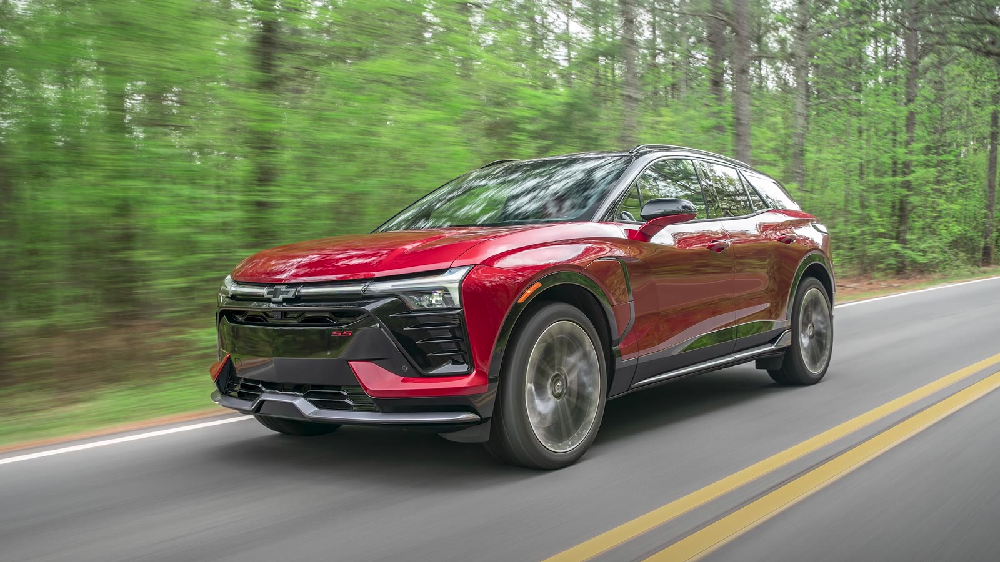

# WMU EcoCAR

Western Michigan University's team in the **EcoCAR Innovation Challenge** (GM track), the
U.S. Department of Energy and General Motors advanced vehicle technology competition managed
by Argonne National Laboratory. Students from across engineering and computer science
re-engineer a Chevrolet Blazer EV with connected and automated driving features.
Faculty advisor: Dr. Zachary Asher.

**Start here**

- [Vision talk slides](https://wmu-ecocar.github.io/eic--vision-talk--main/): what we are
  building and why
- [`eic--cav-controls--matlab`](https://github.com/WMU-EcoCAR/eic--cav-controls--matlab):
  adaptive cruise and lane centering in Simulink
- `eic--sensors--main` (team members): the lab's radars, cameras, lidar and GPS, with
  manuals, drivers and how-tos

Repository names follow `eic--<subject>--<artifact>`.

Photos: launch by Matthew LaVere Photography for AVTC; vehicle image from the EcoCAR
Innovation Challenge.
